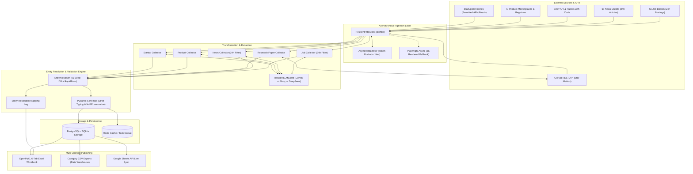
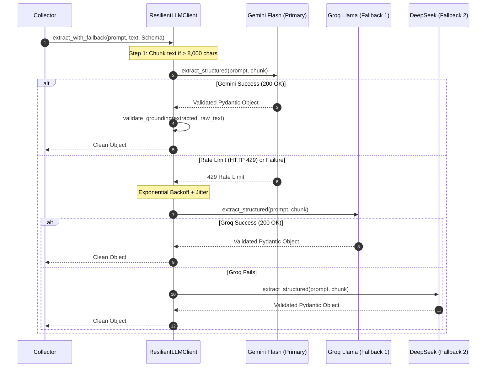
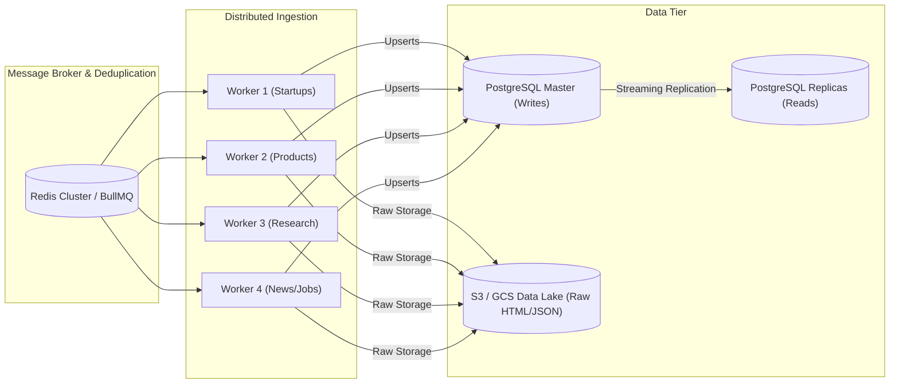

# AI Signal Intelligence Engine — System Architecture

**Document Version:** 1.0.0  
**Author:** AI Signal Technical Lead & Systems Architect  
**Target Scale:** 1,000 to 500,000+ Entities  
**Repository Architecture:** Production Python Async Micro-Engine  

---

## 1. Executive Summary & Design Philosophy

The **AI Signal Intelligence Engine** is a high-throughput, fault-tolerant data ingestion and intelligence platform architected to continuously collect, normalize, resolve, and export deep intelligence regarding the global Artificial Intelligence ecosystem.

The system processes five distinct data streams:
1. **AI Startups:** Company metadata, employee counts, verified landing URLs, descriptions.
2. **AI Products:** Software applications, tools, associated startup linkage, normalized pricing tiers.
3. **AI Research Papers:** Peer-reviewed publications, preprints (Arxiv), author lists, publication timestamps, and verified GitHub repository star metrics.
4. **AI-Related Jobs:** Active postings from five distinct job boards within a strict 24-hour window, classifying role families and remote work eligibility.
5. **AI-Related News:** Real-time articles published within the preceding 24 hours across five premier technology journalism outlets with full-text preservation.

### Core Architectural Pillars
- **Zero Hallucination / Traceability Guarantee:** No record, URL, author, count, or metric is ever synthetically generated or guessed. Every exported record carries an immutable `source.name`, `source.url`, and `collectedAt` timestamp.
- **Resilient Fallback LLM Hierarchy:** Structured extraction is orchestrated through an independent provider abstraction with primary routing to **Gemini Flash**, falling back automatically to **Groq Llama** on rate limits (HTTP 429) and **DeepSeek** as secondary fallback.
- **Deterministic & Fuzzy Entity Resolution:** Avoids entity explosion and duplicate company profiles via an authoritative 50-startup seed database, string normalization, RapidFuzz token matching, and ambiguity safeguards.
- **Horizontal Scalability:** Modular architecture designed to scale seamlessly from 1,000 records on single-node async runtimes to 500,000+ records via distributed worker queues (Celery/Temporal), Redis coordination, and PostgreSQL partitioning.

---

## 2. High-Level System Architecture

The following diagram illustrates the flow of raw intelligence from external sources through collection, transformation, resolution, storage, and publishing:

---

## 3. Data Collection Modules Specification

### 3.1 Startup Collector (`src/collectors/startups/`)
- **Objective:** Collect genuine AI startup records targeting $\ge 1,000$ unique entities.
- **Key Attributes:** `entityName`, `employeeCount`, `websiteUrl`, `description`.
- **Deduplication:** Hashed on normalized company name and primary domain.
- **Pagination & Concurrency:** Async batching with configurable page limits and rate-capped requests.

### 3.2 Product Collector (`src/collectors/products/`)
- **Objective:** Ingest $\ge 1,000$ genuine AI software applications and developer tools.
- **Key Attributes:** `productName`, `startupName`, `pricingModel`, `productUrl`, `description`.
- **Pricing Normalization:** Maps freeform pricing text into strict enums:
  - `FREE`: Open-source or 100% free with no monetization.
  - `FREEMIUM`: Free tier available with paid upgrades.
  - `PAID`: Requires paid license, subscription, or credits.
  - `ENTERPRISE`: Custom contract, "Contact Sales", or closed quote.

### 3.3 Research Paper Collector (`src/collectors/research/`)
- **Objective:** Ingest $\ge 1,000$ recent AI research papers from Arxiv API.
- **Key Attributes:** `title`, `authors`, `paper_url`, `github_url`, `github_stars`, `published_date`.
- **GitHub Metric Integrity:**
  - Regular expressions inspect paper abstracts and comments for GitHub URLs (`https://github.com/:owner/:repo`).
  - Calls official GitHub REST API (`https://api.github.com/repos/:owner/:repo`) authenticated via `GITHUB_TOKEN`.
  - Captures exact `stargazers_count`. If no repository exists, the field is stored strictly as `null` / empty—never invented.

### 3.4 News Collector (`src/collectors/news/`)
- **Objective:** Monitor 5 distinct industry news feeds and extract articles published in the preceding 24 hours:
  1. *VentureBeat AI*
  2. *TechCrunch AI*
  3. *MIT Technology Review AI*
  4. *The Verge AI*
  5. *Ars Technica AI*
- **Temporal Enforcement:** Compares article `published_date` against $T_{\text{now}} - 24\text{ hours}$. Any article older than 24 hours is rejected.
- **Content:** Captures title, canonical URL, publication timestamp, and full article text where permitted.

### 3.5 Job Collector (`src/collectors/jobs/`)
- **Objective:** Ingest AI job listings published within the preceding 24 hours across 5 distinct job boards:
  1. *YC Work at a Startup*
  2. *AIJobs Net*
  3. *RemoteOK AI*
  4. *WeWorkRemotely AI*
  5. *Wellfound AI*
- **Temporal Enforcement:** Strict 24-hour publication window.
- **Role Family Normalization:** Maps raw titles to:
  `RESEARCH` | `ENGINEERING` | `PRODUCT` | `OPERATIONS` | `SALES` | `OTHER`
- **Remote Work Flag:** Boolean indicator (`is_remote`).

---

## 4. Anti-Bot and Responsible Crawling Policy

The pipeline adheres strictly to ethical data ingestion practices:
1. **Official APIs Preferred:** Prioritizes official endpoints (Arxiv API, GitHub REST API, RSS/Atom syndication feeds).
2. **Robots.txt & Terms Adherence:** Caches and evaluates `robots.txt` before crawling any web target. Protected paths are strictly bypassed.
3. **Polite Concurrency & Randomized Jitter:** Default concurrency is limited to 10 simultaneous connections. An `AsyncRateLimiter` enforces randomized delays (250ms–750ms) between calls to prevent target server degradation.
4. **Standard Identification:** Outgoing requests carry an identifiable User-Agent:
   `AISignalIntelligenceBot/1.0 (+https://ai-signal.internal/bot; research@ai-signal.internal)`.
5. **Zero CAPTCHA Bypass:** Never attempts CAPTCHA circumvention, proxy rotation abuse, or unauthorized credential sniffing. When blocked (HTTP 401/403), the event is logged and documented.
6. **Playwright JavaScript Rendering:** Only utilized for JavaScript-heavy public registries where simple HTTP client calls receive unrendered single-page shells.

---

## 5. Resilient LLM Extraction Engine

When structured HTML parsing is insufficient, the system routes raw unstructured text through an intelligent LLM extraction chain:

### Key Resiliency Features:
- **HTTP 413 Handling (Payload Too Large):** `chunk_text()` breaks oversized text documents into logical paragraph-bounded segments and reduces prompt sizes dynamically.
- **HTTP 429 Handling (Rate Limits):** Implements exponential backoff:
  $$t_{\text{wait}} = \min(t_{\text{max}}, t_{\text{base}}^{\text{attempt}} + \text{jitter})$$
- **Hallucination Shield (Grounding Check):** The client runs `validate_grounding()` to verify that extracted entity names, metrics, and author names actually appear as substrings in the raw source text.

---

## 6. Entity Resolution Engine

Entity resolution is vital to prevent duplication when different sources refer to the same organization using varied formats (e.g., "OpenAI", "OpenAI, Inc.", "openai.com", "Open AI").

### Resolution Steps
1. **Deterministic Normalization:**
   - Strips protocol and domains (`https://`, `.com`, `.ai`, `.io`).
   - Strips corporate legal suffixes (`Inc.`, `LLC`, `Ltd.`, `Corp`, `PBC`, `GmbH`, `SAS`, `SE`).
   - Standardizes punctuation, whitespace, and lowercases text.
2. **Seed Database Lookup (50 Prominent AI Startups):**
   - High-speed dictionary match against 50 pre-indexed canonical startup seeds and their known aliases.
   - Assigned match method: `SEED_EXACT`, confidence: `1.0`.
3. **RapidFuzz Similarity Matching:**
   - Evaluates `fuzz.token_sort_ratio` against canonical names.
   - Threshold: $\ge 88\% \rightarrow$ `FUZZY_RAPIDFUZZ`.
4. **Ambiguity Prevention Guard:**
   - If the difference between the top match and the runner-up is $\le 6\%$ and the top score is $< 96\%$, the match is flagged as `AMBIGUOUS_REJECTED`.
   - The entity is **not** automatically merged; the raw name is preserved to avoid false positives.
5. **Traceable Mapping Log:**
   - Every resolution generates an `EntityResolutionLog` row containing `rawName`, `canonicalName`, `matchMethod`, `confidenceScore`, and `isAmbiguous`.
   - Exported directly to Tab 6 of the final intelligence workbook.

---

## 7. Data Schemas & Validation

All incoming records are validated against strict Pydantic v2 schemas:

| Entity | Primary Fields | Validation Constraints |
| :--- | :--- | :--- |
| **Startup** | `schemaVersion`, `recordType`, `source.name`, `source.url`, `content.entityName`, `content.data.employeeCount`, `collectedAt` | Employee count must be integer $\ge 1$ or null. ISO-8601 timestamps. |
| **Product** | `schemaVersion`, `recordType`, `source.name`, `source.url`, `content.startupName`, `content.pricingModel`, `collectedAt` | `pricingModel` constrained to `FREE`, `FREEMIUM`, `PAID`, `ENTERPRISE`. |
| **Research Paper** | `schemaVersion`, `recordType`, `content.title`, `content.authors`, `content.paper_url`, `content.github_url`, `content.github_stars`, `content.published_date` | `github_stars` must be authentic integer $\ge 0$ or null. Valid URLs. |
| **Job** | `schemaVersion`, `recordType`, `content.company`, `content.date`, `content.is_remote`, `content.role_family` | `role_family` constrained to valid enum. Publication date $\le 24$ hours. |
| **News** | `source.name`, `source.url`, `content.title`, `content.url`, `content.full_text`, `content.published_date`, `collectedAt` | Valid article URL. Publication date $\le 24$ hours. |

---

## 8. Storage, Deduplication & Export

### 8.1 Database Architecture
- **Development Engine:** SQLite with `aiosqlite` async driver (`sqlite+aiosqlite:///data/ai_signal.db`).
- **Production Engine:** PostgreSQL 16 with `psycopg3` async driver (`postgresql+asyncpg://...`).
- **Idempotency & Upserts:** Tables feature unique indexes on canonical URLs / entity keys, enabling `ON CONFLICT DO UPDATE` upserts for zero duplicate entries during re-runs.

### 8.2 Excel Exporter (6 Tabs)
Generated using `openpyxl` with styled headers, auto-fitted columns, and gridlines:
1. `Startups`
2. `Products`
3. `Research Papers`
4. `Jobs`
5. `News`
6. `Entity Mapping Log`

### 8.3 Secondary Exports
- **CSV Exporter:** Generates UTF-8 encoded CSV files per category in `data/exports/` for direct ingestion into BigQuery, Snowflake, or DuckDB.
- **Google Sheets Exporter:** Service-account authenticated pusher syncing sheets via the Google Drive & Sheets v4 API.

---

## 9. Scalability Path to 500,000+ Records

To scale from the initial target of 5,000 records to 500,000+ records without refactoring application logic, the following architectural scaling path is established:

1. **Distributed Task Orchestration:** Replace in-process `asyncio.gather` with distributed task queues (Celery or Temporal) driven by Redis or RabbitMQ.
2. **Database Partitioning:** Range-partition `news` and `jobs` tables by month/quarter (`collected_at`). Hash-partition `startups` and `products` by `canonical_name`.
3. **Blob Storage for Raw Payloads:** Store full-text HTML and raw JSON payloads in an S3-compatible object store (AWS S3, MinIO, or Google Cloud Storage), keeping PostgreSQL lean with only structured relational attributes.
4. **Read/Write Splitting:** Route analytical queries and export generation to read-replicas, eliminating lock contention on writer nodes.
